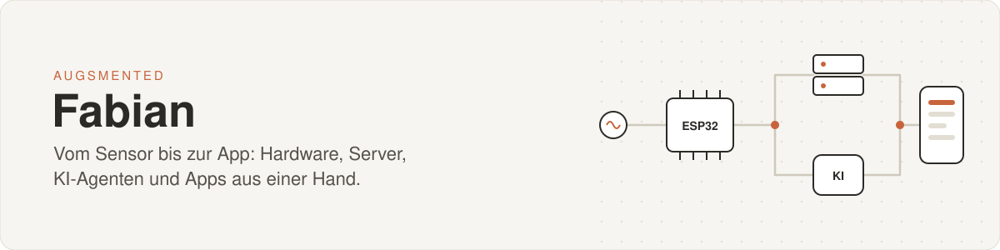

 

Ich baue Systeme, die vom ersten Sensor bis zur fertigen App durchgehend funktionieren.
Hauptberuflich leite ich ein App-Team, nebenbei entwickle ich mit **Augsmented** eigene Apps, KI-Agenten und KI-Videos.
Meine Stärke ist, dass ich jede Schicht selbst beherrsche: Schaltung, Firmware, Server, Backend, App und die KI obendrauf.

 

## Was ich kann

<table>
<tr>
<td width="33%" valign="top">

#### Apps entwickeln
- Apps für iOS, Android und Web aus einer Codebasis (Ionic, Angular, Capacitor)
- Backends und REST-APIs in .NET und Node.js
- Login mit Rollen, Buchungslogik, Push, Kalender-Abo, Zahlungen
- Anbindung an Gesundheits-Infrastruktur (TI: KIM, E-Rezept)

</td>
<td width="33%" valign="top">

#### KI-Agenten bauen
- Eigene Agenten mit Claude, die Aufgaben selbstständig abarbeiten
- Mehrere Agenten parallel, mit Prüfschritten und Freigaben
- Chat-Bots, Ticket-Autopilot, automatische Berichte
- Teams in KI-Werkzeugen schulen und KI im Alltag einführen

</td>
<td width="33%" valign="top">

#### Server betreiben
- Linux-Server aufsetzen, absichern und rund um die Uhr betreiben
- Docker, VPN, eigene Chat-Server (Matrix), Backups
- Netzwerke mit IPv4 und IPv6, Tunnel, Fernwartung
- GPU-Rechner in der Cloud mieten und automatisieren

</td>
</tr>
<tr>
<td width="33%" valign="top">

#### Hardware und IoT
- Mikrocontroller programmieren (ESP32, ATmega, Raspberry Pi)
- Sensoren auslesen und Daten bis in die App bringen
- Schaltungen entwerfen, messen, regeln, Fehler suchen
- Anlagen bauen, die im Dauerbetrieb laufen

</td>
<td width="33%" valign="top">

#### KI-Video und 3D
- Erklärvideos mit KI-Videomodellen (Wan) erzeugen
- Wiederkehrende Figuren als 3D-Avatare in Blender
- Schnitt und Ton automatisiert mit ffmpeg
- Automatische Qualitätsprüfung vor jeder Veröffentlichung

</td>
<td width="33%" valign="top">

#### Führen und ausbilden
- Ein Entwicklungsteam leiten, Tickets schneiden, Features planen
- Zwischen Technik und Fachseite übersetzen
- Schulungen halten, Einsteiger einarbeiten
- Ausgebildeter Ausbilder mit langjähriger Praxis

</td>
</tr>
</table>

 

## Was ich gerade baue

<table>
<tr>
<td width="50%" valign="top">

### Stadtling
Eine Städte-App für die lokale Community: Orte aus OpenStreetMap und Open Data, Ränge und Taler für aktive Leute, KI-Moderation für Beiträge und Bilder.

</td>
<td width="50%" valign="top">

### TOM
Unser eigener KI-Agent auf einem Server: nimmt Aufträge per Chat entgegen, erledigt sie selbstständig, meldet Fehler und schickt abends eine Zusammenfassung.

</td>
</tr>
<tr>
<td width="50%" valign="top">

### KI-Video-Pipeline
Vom Drehbuch zum fertigen Erklärvideo: Szenen als Bilder planen, auf gemieteten GPUs zu Clips rendern, Avatare in Blender, Endprüfung auf Logik und Bildfehler.

</td>
<td width="50%" valign="top">

### [DriveSync](https://github.com/Oneclub1/DriveSync)
Fahrstunden online buchen und stornieren. Fahrlehrer verwalten Zeitfenster und Sperrzeiten, Schüler bekommen Erinnerungen und ein Kalender-Abo.

</td>
</tr>
</table>

 

## Werkzeugkasten

**Apps und Backend** 

**KI und Automatisierung** 

**Server und Hardware** 

 

## So arbeite ich

- **Erst verstehen, dann bauen.** Ich kläre, was wirklich gebraucht wird, bevor die erste Zeile Code entsteht.
- **Fertig heißt: läuft im Betrieb.** Nicht nur auf meinem Rechner, sondern dauerhaft und überwacht.
- **Werkzeuge für andere.** Am meisten Spaß macht mir, was anderen täglich Arbeit abnimmt.

 

---

Projekte entstehen im Zweierteam unter dem Namen <b>Augsmented</b>.

